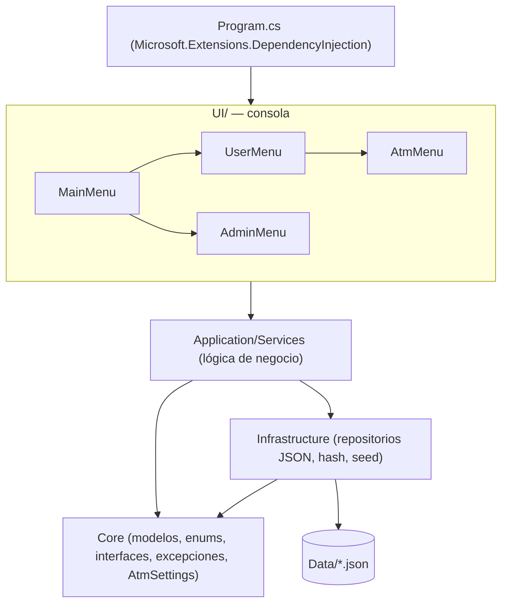

# 🏧 ATM2 — Simulador de Cajero Automático (.NET 10)

Aplicación de consola interactiva en **C# / .NET 10** que simula el funcionamiento completo de un cajero automático (ATM) y una banca en línea básica, utilizando persistencia local en archivos **JSON** y arquitectura en capas.

---

## ✨ Características Principales

### 👤 Clientes (Banca y Cajero)
- **Registro e Inicio de Sesión:** Creación automática de cuenta de ahorros al registrarse.
- **Emisión de Tarjetas (Simulada):** Generación de tarjetas de débito de 16 dígitos validadas con el **algoritmo de Luhn** y vigencia de 4 años.
- **Seguridad con PIN y Contraseña:**
  - Entrada oculta en consola (`****`).
  - Hashing criptográfico con **PBKDF2 (SHA-256)**, *salt* aleatorio de 16 bytes y 100,000 iteraciones.
  - Bloqueo automático de tarjeta o cuenta tras **3 intentos fallidos**.
  - Expiración de sesión tras **5 minutos de inactividad**.
- **Operaciones en Cajero (requiere insertar tarjeta + PIN):**
  - **Consulta de saldo** en tiempo real.
  - **Retiro de efectivo:** Montos rápidos (\$500, \$1,000, \$2,000, \$5,000) u otro monto en múltiplos de \$100 (máx. \$10,000 por operación).
  - **Depósito de efectivo:** Hasta \$50,000 por operación.
  - **Pago de deudas:** Pago total o abono parcial a créditos activos descontando de la cuenta.
  - **Transferencias:** Envío de dinero a otros usuarios registrados mediante su correo electrónico.
  - **Cambio de PIN** y **emisión de comprobantes** en consola por operación.
- **Créditos y Deudas:** Solicitud de préstamos con 10% de interés (aprobación y desembolso automático hasta \$10,000; montos mayores requieren aprobación del administrador).
- **Soporte:** Creación y seguimiento de tickets de atención al cliente.

### 🛡️ Panel de Administración
- **Auditoría de Transacciones:** Historial global filtrable por tipo (*Todos*, *Retiros*, *Pagos de deuda*, *Depósitos*) que detalla qué usuario realizó la operación y con qué tarjeta.
- **Gestión de Usuarios:** Listado general y bloqueo/desbloqueo de cuentas de clientes.
- **Gestión de Créditos:** Aprobación (con desembolso inmediato) o rechazo de solicitudes mayores a \$10,000.
- **Gestión de Tarjetas:** Bloqueo y desbloqueo de tarjetas de débito.
- **Gestión de Tickets:** Revisión y cambio de estado (*Abierto*, *En progreso*, *Resuelto*, *Cerrado*).

---

## 🧱 Arquitectura y Estructura del Proyecto

El proyecto está organizado siguiendo principios de separación de responsabilidades en 4 capas:



```text
ATM2/
├── Program.cs                        # Punto de entrada: registra dependencias (Microsoft.Extensions.DependencyInjection)
├── ATM_2.0.csproj                    # Proyecto .NET 10 (ensamblado: ATM2)
├── Core/                             # Dominio (sin dependencias externas)
│   ├── AtmSettings.cs                # Reglas y límites de negocio centralizados
│   ├── Guard.cs                      # Validaciones reutilizables (monto positivo)
│   ├── IdFormatter.cs                # Id corto para mostrar al usuario
│   ├── Enums/                        # AccountType, CardStatus, CreditStatus, TicketStatus, TransactionType, UserRole
│   ├── Exceptions/                   # AtmException y excepciones de negocio específicas
│   ├── Interfaces/                   # Contratos de Repositorios, Servicios, Seguridad e IEntity
│   └── Models/                       # User, Account, Card, Credit, Transaction, Ticket, Session
├── Application/                      # Casos de uso y reglas de negocio
│   ├── AppServices.cs                # Contenedor de servicios de aplicación
│   └── Services/                     # AuthService, AccountService, CardService, CreditService, etc.
├── Infrastructure/                   # Persistencia y servicios técnicos
│   ├── Json/                         # JsonContext y JsonService (escritura atómica .tmp + caché por archivo)
│   ├── Repositories/                 # JsonRepository<T> base y repositorios por entidad
│   ├── Security/                     # PasswordHasher (PBKDF2-SHA256)
│   └── Seed/                         # DataSeeder (creación del administrador por defecto)
├── UI/                               # Interfaz de usuario en consola
│   ├── ConsoleHelper.cs              # Lectura validada, máscaras de PIN/clave, menús y colores
│   ├── Display.cs                    # Formato de moneda, fechas, comprobantes y máscaras de tarjeta
│   └── Menus/                        # MainMenu, UserMenu, AtmMenu, AdminMenu, SessionMenu
├── Data/                             # Archivos JSON autogenerados (ignorados en Git)
└── docs/                             # Documentación local de revisión y cambios (ignorada en Git)
    ├── README_ERRORES.md
    └── README_VISION.md
```

### Detalle por Capa y Cambios Implementados

#### Core
- **Utilidades y reglas:**
  - `AtmSettings`: centraliza los límites de seguridad, cajero, créditos, vigencia de tarjetas y filas mostradas en pantalla.
  - `Guard`: validaciones reutilizables (por ejemplo, `Guard.Positive(amount)`).
  - `IdFormatter`: genera identificadores cortos de 8 caracteres en mayúsculas seguros para ids cortos (`IdFormatter.Short`).
- **Modelos:**
  - `User`: `PasswordHash`, `CreatedAt`, `FailedLoginAttempts` y `LastLoginAt` (el PIN ya no pertenece al usuario sino a la tarjeta).
  - `Account`: `CreatedAt`, tipo de cuenta, saldo y estado activo.
  - `Card`: número de 16 dígitos validado con Luhn, titular, `PinHash`, estado, intentos fallidos y fecha de vencimiento.
  - `Transaction`: registra `UserId`, `CardId`, `BalanceAfter` y `RelatedAccountId` para auditoría completa.
  - `Credit`: `InterestRate` como `decimal`, `TotalToPay`, `RemainingBalance` y `PaidAt`.
  - `Session`: sesión en memoria con `LastActivityAt` para expiración por inactividad.
  - `Ticket`: soporte con asunto, descripción, estado y `ResolvedAt`.
  - Todos los modelos persistidos en JSON implementan `IEntity` (`Id`).
- **Enums:** `CardStatus` (`Active`, `Blocked`, `Cancelled`), `TransactionType` (`Deposit`, `Withdrawal`, `TransferOut`, `TransferIn`, `DebtPayment`, `CreditDisbursement`), `TicketStatus` (`Open`, `InProgress`, `Resolved`, `Closed`), `AccountType`, `CreditStatus` y `UserRole`.
- **Excepciones:** clase base `AtmException` (capturada por la UI para mostrar mensajes claros en español) y específicas `AccountLockedException`, `CardBlockedException`, `InsufficientFundsException`, `InvalidCredentialsException`, `InvalidPinException`, `InvalidSessionException` y `UserNotFoundException`.
- **Interfaces:**
  - Repositorios: `IUserRepository`, `IAccountRepository`, `ICardRepository`, `ITransactionRepository`, `ICreditRepository`, `ITicketRepository`.
  - Servicios: `IAuthService` (`Register`, `Login`, `Logout`, `IsSessionActive → bool`), `ICardService` (`Request`, `ValidatePin`, `ChangePin`, `Block`, `Unblock`, consultas), `ICreditService` (`Request`, `Approve`, `Reject`, `Pay`, `GetPendingDebts`, consultas), `ISessionService` (`Create`, `GetById`, `GetActive`, `End`, `IsActive`, `EnsureActive`), `IAccountService` (`Create`, `GetBalance`, `Deposit`, `Withdraw`, `Transfer`), `IUserService`, `ITicketService`, `ITransactionService`.
  - Seguridad: `IPasswordHasher`.

#### Application
| Servicio | Responsabilidad |
| :--- | :--- |
| `AuthService` | Registro (valida nombre, correo y contraseña; crea cuenta de ahorros), login con bloqueo tras 3 intentos fallidos (los administradores no se bloquean) y una única sesión activa por usuario. |
| `SessionService` | Gestión de sesiones en memoria con expiración automática por inactividad. |
| `AccountService` | Depósitos, retiros y transferencias; cada movimiento genera una `Transaction` con usuario, tarjeta y saldo resultante. |
| `CardService` | Emisión de tarjetas simuladas con Luhn, validación de PIN (bloqueo al 3.er fallo), cambio de PIN y bloqueo/desbloqueo. |
| `CreditService` | Solicitud de créditos (aprobación automática ≤ \$10,000 o pendiente para admin), aprobación/rechazo y pago total o parcial de deudas. |
| `TransactionService` | Registro y consultas ordenadas de movimientos por cuenta, usuario o globales. |
| `UserService` | Consulta, actualización y bloqueo/desbloqueo de usuarios. |
| `TicketService` | Creación y actualización de estado de tickets de soporte. |

#### Infrastructure
- `JsonService`: crea automáticamente el directorio `Data/`, realiza escritura atómica mediante archivos temporales `.tmp`, serializa enums como texto, informa errores claros si un JSON está dañado y mantiene caché del texto JSON en memoria invalidada por `LastWriteTimeUtc` o al escribir (acceso protegido con `lock`).
- `JsonContext`: define `BasePath` en `<carpeta de trabajo>/Data/` y los nombres de archivos (`users.json`, `accounts.json`, `cards.json`, `transactions.json`, `credits.json`, `tickets.json`).
- `JsonRepository<T>`: repositorio base genérico con operaciones CRUD comunes del que heredan los repositorios concretos.
- `PasswordHasher`: hashing PBKDF2-SHA256 con salt aleatorio de 16 bytes y 100,000 iteraciones para contraseñas y PINs.
- `DataSeeder`: crea automáticamente el usuario administrador inicial si aún no existe alguno.

#### UI
- `MainMenu`: registro, inicio de sesión y salida.
- `UserMenu`: ver cuenta, solicitar tarjeta, ver tarjetas, insertar tarjeta para usar cajero, solicitar crédito, ver créditos/deudas, historial de movimientos y tickets de soporte.
- `AtmMenu`: consulta de saldo, retiro (montos rápidos u otro), depósito, pago de deuda, transferencia por correo, últimos movimientos, cambio de PIN y retiro de tarjeta con emisión de comprobante.
- `AdminMenu`: listado de usuarios (roles en español), bloqueo/desbloqueo de usuarios, auditoría de transacciones con filtros (retiros, pagos de deuda, depósitos) mostrando usuario y tarjeta, aprobación/rechazo de créditos, bloqueo/desbloqueo de tarjetas y gestión de tickets.
- `SessionMenu`: clase base que revalida la sesión activa antes de cada operación y maneja excepciones de negocio.
- `ConsoleHelper` y `Display`: lectura oculta con `****` para claves/PIN, validación de entradas, mensajes centralizados (`Cancelled()`), formato de moneda, fechas, comprobantes y máscaras de tarjeta.

#### Configuración
- `ATM_2.0.csproj`: `RootNamespace` y `AssemblyName` configurados en `ATM2` y referencia al paquete `Microsoft.Extensions.DependencyInjection` (11.0.0).
- `.vscode/launch.json`: configurado con `integratedTerminal` y ruta `bin/Debug/net10.0/ATM2.dll`.
- `.gitignore`: ignora `Data/`, `docs/`, `Claude.md`, `bin/`, `obj/`, `.vs/` y `.vscode/`.

---

## 🚀 Requisitos y Ejecución

### Requisitos previos
- [.NET 10 SDK](https://dotnet.microsoft.com/download) instalado.

### Ejecutar el proyecto
En la raíz del repositorio, ejecuta:

```powershell
dotnet run
```

También puedes iniciarlo con **F5** en VS Code. La carpeta `Data/` y los archivos `.json` (`users.json`, `accounts.json`, `cards.json`, `transactions.json`, `credits.json`, `tickets.json`) se crean automáticamente al iniciar la aplicación.

### Flujo de prueba rápido
1. **Registrarse** → se crea automáticamente una cuenta de ahorros.
2. **Iniciar sesión** → *Solicitar tarjeta* (eliges un PIN de 4 dígitos).
3. *Solicitar crédito* (≤ \$10,000 se aprueba al instante) → obtienes saldo inicial y una deuda activa.
4. *Usar cajero* → seleccionas la tarjeta → ingresas PIN → retiras, depositas, **pagas deuda** o transfieres.
5. Cierra sesión y entra como **admin** → *Auditoría de transacciones* muestra quién realizó cada operación y con qué tarjeta.

---

## 🔑 Credenciales por Defecto (Administrador)

En la primera ejecución, `DataSeeder` registra automáticamente una cuenta de administrador:

| Campo | Valor |
| :--- | :--- |
| **Correo** | `admin@atm.com` |
| **Contraseña** | `admin123` |

Para usar otras credenciales, define las variables de entorno `ATM_ADMIN_EMAIL` y `ATM_ADMIN_PASSWORD` **antes de la primera ejecución** (si ya existe `Data/users.json`, el admin ya fue creado).

```powershell
$env:ATM_ADMIN_EMAIL = "yo@miatm.com"
$env:ATM_ADMIN_PASSWORD = "UnaClaveMasSegura"
dotnet run
```

---

## ⚙️ Reglas de Negocio Configurables (`AtmSettings.cs`)

| Parámetro | Valor por defecto | Descripción |
| :--- | :--- | :--- |
| `PinLength` | `4` | Cantidad de dígitos numéricos del PIN de tarjeta |
| `MinPasswordLength` | `6` | Longitud mínima de la contraseña de usuario |
| `MaxPinAttempts` / `MaxLoginAttempts` | `3` | Intentos fallidos antes de bloquear tarjeta o usuario |
| `SessionTimeoutMinutes` | `5` | Minutos de inactividad antes de expirar la sesión |
| `CardValidityYears` | `4` | Años de vigencia de cada tarjeta emitida |
| `WithdrawalMultiple` | `$100` | Denominación mínima permitida para retiros |
| `MaxWithdrawalPerTransaction` | `$10,000` | Monto máximo por retiro en cajero |
| `MaxDepositPerTransaction` | `$50,000` | Monto máximo por depósito en cajero |
| `CreditInterestRate` | `10%` | Tasa de interés fija aplicada a créditos |
| `CreditAutoApprovalLimit` | `$10,000` | Tope para aprobación y desembolso automático |
| `MaxCreditAmount` | `$100,000` | Monto máximo solicitable en un crédito |
| `QuickWithdrawalAmounts` | `500 / 1,000 / 2,000 / 5,000` | Montos rápidos del menú de retiro |
| `HistoryRows` / `MiniStatementRows` / `AuditRows` | `20 / 10 / 50` | Filas mostradas en historial, últimos movimientos y auditoría |

---

## ✅ Verificación

- **Compilación (`dotnet build`):** 0 errores, 0 advertencias.
- **Pruebas funcionales en consola (entrada simulada):**
  - Registro de usuarios, solicitud de tarjeta, solicitud de crédito con desembolso automático, retiro, depósito, pago parcial de deuda, transferencia entre cuentas, rechazo de retiro no múltiplo de \$100, consulta de historial y auditoría como administrador.
  - Bloqueo de seguridad: 3 intentos de PIN incorrecto bloquean la tarjeta (`CardStatus.Blocked`); 3 intentos de contraseña incorrecta bloquean al usuario (`IsLocked = true`).

---

## 📚 Documentación Adicional

La carpeta `docs/` es **local** (está en `.gitignore` y no se sube al repositorio):

- `docs/README_ERRORES.md` — errores encontrados y corregidos (3 rondas de calidad/convención)
- `docs/README_VISION.md` — hoja de ruta y próximos pasos
