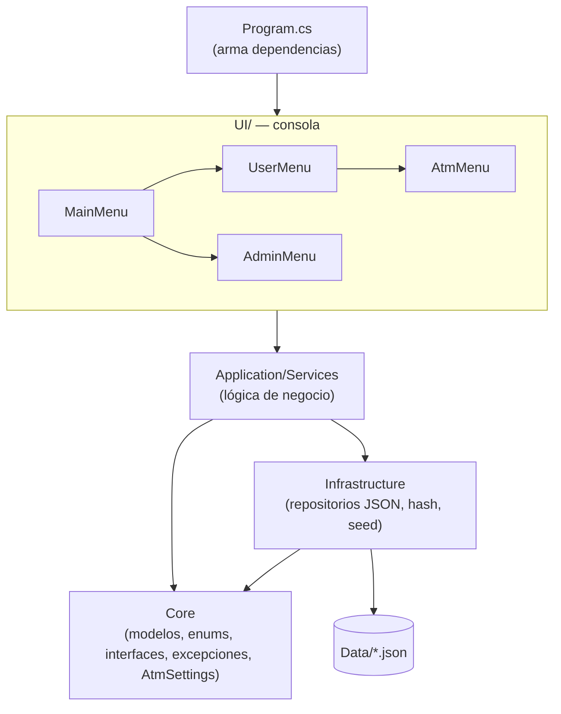

# Cambios realizados — ATM2

Cajero automático de consola en **.NET 10** con persistencia en **JSON**.
Funciones: registro / inicio de sesión, solicitar tarjeta (simulada), PIN de seguridad, consultar saldo,
retirar, depositar, transferir, solicitar crédito, pagar deudas, historial y panel de administración
para auditar **quién** retiró o pagó deudas.

> Los problemas que motivaron estos cambios están detallados en [README_ERRORES.md](README_ERRORES.md).

---

## Cómo ejecutar

```powershell
dotnet run
```

o **F5** en VS Code. Los datos se guardan en `Data/` (en la raíz del proyecto) y se crean solos.

**Administrador por defecto** (se crea la primera vez): `admin@atm.com` / `admin123`

### Flujo de prueba rápido
1. **Registrarse** → se crea automáticamente una cuenta de ahorros.
2. **Iniciar sesión** → *Solicitar tarjeta* (eliges un PIN de 4 dígitos).
3. *Solicitar crédito* (≤ 10 000 se aprueba al instante) → así tienes saldo y una deuda.
4. *Usar cajero* → eliges la tarjeta → PIN → retirar / depositar / **pagar deuda** / transferir.
5. Cierra sesión y entra como **admin** → *Auditoría de transacciones* muestra quién hizo cada operación y con qué tarjeta.

---

## Arquitectura



```
ATM2/
├── Program.cs                     ← punto de entrada (DI manual)
├── Core/
│   ├── AtmSettings.cs             ← NUEVO: límites y reglas configurables
│   ├── Enums/                     (+ CardStatus)
│   ├── Exceptions/                (+ AtmException, CardBlocked, InvalidPin, InvalidCredentials)
│   ├── Interfaces/
│   │   ├── IEntity.cs             ← NUEVO
│   │   ├── Repositories/          (+ ICardRepository; IAccaount → IAccount)
│   │   ├── Security/              ← NUEVO: IPasswordHasher
│   │   └── Services/              (+ ICardService; IAccaount → IAccount)
│   └── Models/                    (+ Card)
├── Application/                   ← NUEVO
│   ├── AppServices.cs
│   └── Services/                  Account, Auth, Card, Credit, Session, Ticket, Transaction, User
├── Infrastructure/
│   ├── Json/                      JsonContext, JsonService
│   ├── Repositories/              (+ JsonRepository<T> genérico, CardRepository)
│   ├── Security/                  ← NUEVO: PasswordHasher (PBKDF2)
│   └── Seed/                      ← NUEVO: DataSeeder (admin inicial)
├── UI/                            ← NUEVO
│   ├── ConsoleHelper.cs           entrada segura (PIN con ****), menús, colores
│   ├── Display.cs                 formatos de moneda/fecha, traducciones, comprobante
│   └── Menus/                     SessionMenu (base), MainMenu, UserMenu, AtmMenu, AdminMenu
├── Data/                          ← generado al ejecutar (ignorado por git)
└── docs/
```

---

## Detalle de cambios por capa

### Core
- **`AtmSettings.cs` (nuevo):** todas las reglas en un solo lugar.

  | Regla | Valor |
  |---|---|
  | Largo del PIN | 4 dígitos |
  | Intentos de PIN / contraseña | 3 |
  | Expiración de sesión | 5 min de inactividad |
  | Retiro | múltiplos de 100, máx. 10 000 por operación |
  | Depósito | máx. 50 000 por operación |
  | Crédito | 10 % interés, aprobación automática ≤ 10 000, máximo 100 000 |
  | Vigencia de tarjeta | 4 años |

- **Modelos**
  - `User`: `PasswordHas` → `PasswordHash`, `CreateAdt` → `CreatedAt`, se quitó `Pin`, se agregaron `FailedLoginAttempts` y `LastLoginAt`.
  - `Account`: `CreateAdt` → `CreatedAt`.
  - `Card` **(nuevo)**: número de 16 dígitos válido por Luhn, titular, `PinHash`, estado, intentos fallidos, vencimiento.
  - `Transaction`: + `UserId`, `CardId`, `BalanceAfter`; `TargetAccountId` → `RelatedAccountId`.
  - `Credit`: `InterestRate` a `decimal`, + `TotalToPay`, `PaidAt`.
  - `Session`: + `LastActivityAt` (para el timeout).
  - Todos los modelos persistidos implementan `IEntity` (tienen `Id`).
- **Enums:** `CardStatus` (nuevo); `TransactionType` = `Deposit, Withdrawal, TransferOut, TransferIn, DebtPayment, CreditDisbursement`; `TicketStatus.Inprogress` → `InProgress`.
- **Excepciones:** base `AtmException` (la UI la captura y muestra el mensaje); nuevas `CardBlockedException`, `InvalidPinException`, `InvalidCredentialsException`; mensajes en español.
- **Interfaces:** ver tabla 4 de [README_ERRORES.md](README_ERRORES.md#4-errores-de-diseño-en-las-interfaces). Resumen:
  - `IAuthService`: `Register`, `Login` (lanza excepción con motivo), `Logout`, `IsSessionActive → bool`.
  - `ICardService` (nuevo): `Request`, `ValidatePin`, `ChangePin`, `Block`, `Unblock`, consultas.
  - `ICreditService`: + `Pay`, `GetPendingDebts`.
  - `ISessionService`: + `GetById`, `EnsureActive`.
  - `IAccountService`: `Create(userId)`, `GetBalance`, `Deposit/Withdraw` con `cardId` y tipo de transacción.
  - `IUserService`: se quitó `Create` (ahora es `IAuthService.Register`).

### Application (nuevo)
| Servicio | Responsabilidad |
|---|---|
| `AuthService` | Registro (valida nombre, correo, contraseña; crea la cuenta), login con bloqueo tras 3 intentos (los admin no se bloquean), una sesión activa por usuario. |
| `SessionService` | Sesiones en memoria con expiración por inactividad. |
| `AccountService` | Depósito, retiro, transferencia. Cada operación genera una `Transaction` con usuario, tarjeta y saldo resultante. |
| `CardService` | Emite tarjetas simuladas, valida PIN (bloquea al 3.er fallo), cambio de PIN, bloqueo/desbloqueo. |
| `CreditService` | Solicitud (aprobación automática o pendiente para admin), aprobación/rechazo, **pago total o parcial de deudas**. |
| `TransactionService`, `UserService`, `TicketService` | Consultas ordenadas, bloqueo de usuarios, tickets de soporte. |

### Infrastructure
- `JsonService`: crea la carpeta, escritura atómica, enums como texto, error claro si el JSON está dañado.
- `JsonContext`: ruta `Data/` en la carpeta de trabajo; + `cards.json`.
- `JsonRepository<T>` (nuevo): CRUD genérico; los repositorios heredan de él.
- `PasswordHasher` (nuevo): PBKDF2 para contraseñas y PIN.
- `DataSeeder` (nuevo): crea el admin si no existe.

### UI (nuevo)
- **Menú principal:** Registrarse · Iniciar sesión · Salir.
- **Menú cliente:** Ver cuenta · Solicitar tarjeta · Mis tarjetas · Usar cajero · Solicitar crédito · Mis créditos · Historial · Tickets de soporte.
- **Cajero (tarjeta + PIN):** Saldo · Retirar (montos rápidos u otro) · Depositar · Pagar deuda · Transferir por correo · Últimos movimientos · Cambiar PIN · Retirar tarjeta. Imprime comprobante.
- **Admin:** Usuarios · Bloquear/desbloquear · **Auditoría** (filtro por retiros / pagos de deuda / depósitos, muestra usuario y tarjeta) · Aprobar/rechazar créditos · Bloquear/desbloquear tarjetas · Tickets.
- PIN y contraseñas se escriben con `****`. La sesión se revalida antes de cada operación.

### Configuración
- `ATM_2.0.csproj`: `RootNamespace` → `ATM2`.
- `.vscode/launch.json`: `console` → `integratedTerminal`.
- `.gitignore`: + `Data/`.

---

## Verificación
- `dotnet build` → **0 errores, 0 advertencias**.
- Prueba de punta a punta con entrada simulada: registro de 2 usuarios, tarjeta, crédito, PIN incorrecto + correcto, retiro, depósito, pago parcial de deuda, transferencia, retiro inválido (150 → rechazado por no ser múltiplo de 100), historial y auditoría como admin. ✅
- Seguridad: 3 PIN incorrectos → tarjeta `Blocked`; 3 contraseñas incorrectas → usuario bloqueado, incluso con la contraseña correcta después. ✅

## Ideas para seguir
1. Proyecto de pruebas xUnit para los servicios.
2. Opción para que el cliente reporte su tarjeta como perdida (`CardStatus.Cancelled` ya existe).
3. Límite diario de retiro (sumar los `Withdrawal` del día por tarjeta).
4. Migrar de JSON a SQLite + EF Core cuando el proyecto crezca (las interfaces de repositorio ya lo permiten sin tocar los servicios).
